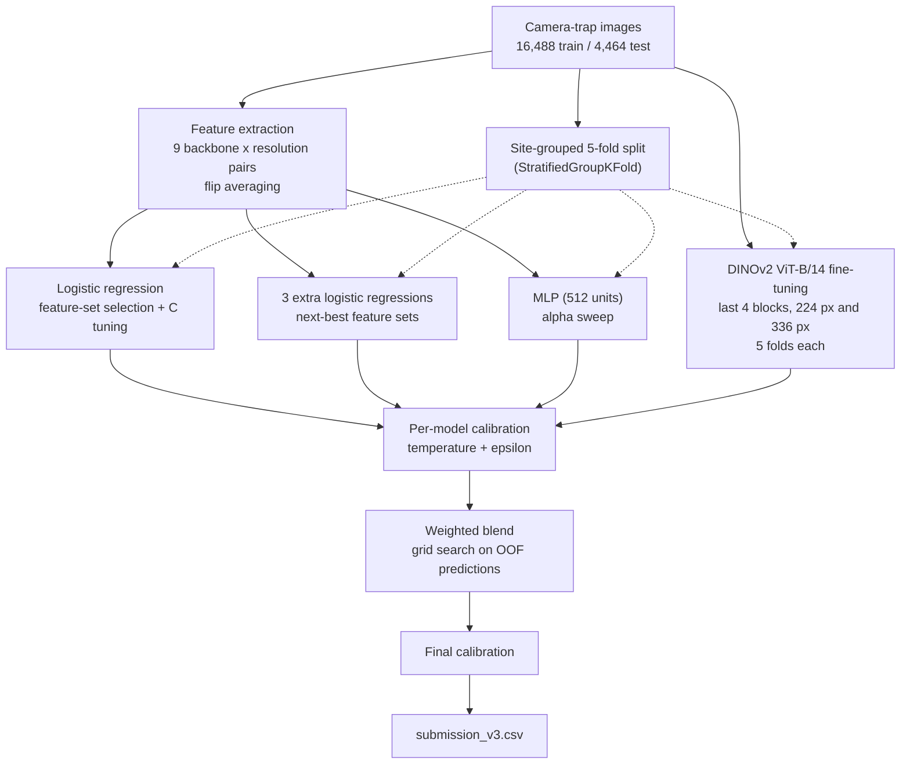
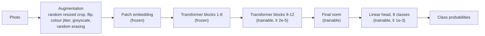

# Conser-vision: Wildlife Camera-Trap Image Classification

An end-to-end pipeline that classifies camera-trap photographs into eight classes (`antelope_duiker`, `bird`, `blank`, `civet_genet`, `hog`, `leopard`, `monkey_prosimian`, `rodent`). It combines features from frozen pretrained backbones, a partially fine-tuned DINOv2, per-model probability calibration and a weighted blend. It was built for the **Conser-vision Practice Area: Image Classification** competition on DrivenData, which uses a small dataset of wildlife captured by camera traps used in conservation research. The competition metric is **multiclass log loss** (lower is better).

The whole solution lives in a single notebook, [`notebooks/conser-vision-wildlife-classifier.ipynb`](notebooks/conser-vision-wildlife-classifier.ipynb).

## Highlights

- **Site-grouped validation.** Folds keep every camera site together, so the out-of-fold (OOF) score estimates performance on cameras the model has never seen. The test set contains 51 sites, none of which appear in training.
- **Multi-resolution features.** Nine backbone and input-size combinations (DINOv2 ViT-B and ViT-L, CLIP, ConvNeXt) at sizes from 224 to 518 px, each averaged with its mirrored view.
- **Partial fine-tuning.** The last four DINOv2 ViT-B blocks are trained with strong augmentation to reduce reliance on camera backgrounds.
- **Calibrated blend.** Each model gets temperature scaling plus a small uniform mix, and blend weights are searched on OOF predictions.
- **Resumable.** Every stage and every fine-tuning fold is checkpointed to disk and skipped on re-run.

## Pipeline architecture



### Fine-tuned model



Training uses AdamW with a one-cycle learning-rate schedule, mixed precision, gradient clipping, label smoothing (0.1) and early stopping on validation log loss. Predictions use horizontal-flip test-time augmentation, and the test predictions of the five fold models are averaged.

## Method

| Stage | What happens | Key settings |
|---|---|---|
| Validation split | `StratifiedGroupKFold` grouped by camera site | 5 folds, seed 42 |
| Feature extraction | Frozen backbone, classifier head removed, embeddings averaged over the image and its mirror | `FEATURE_SPECS` (9 pairs) |
| Logistic regression | Standardised features. Scores each feature set, compares stacking with the best single set, then tunes `C` | `C` in {0.002, 0.004, 0.007} |
| Extra logistic regressions | The next three best feature sets are kept as separate blend components | Tuned `C` |
| MLP | One hidden layer on the best feature set | 512 units, `alpha` in {10, 30, 100} |
| Fine-tuning | DINOv2 ViT-B/14, last blocks trainable, one model per resolution | 224 px (8 epochs), 336 px (6 epochs) |
| Calibration | Temperature scaling and uniform mixing, fitted on OOF predictions | temperature 0.5 to 6, epsilon up to 0.05 |
| Blending | Exhaustive weight search in steps of 0.1 over up to seven components, then one more calibration | Weights sum to 1 |

## Leaderboard result

Public leaderboard log loss of **0.5952**, ranked **7th** (as of 18 October 2026). The leaderboard is open, so positions change as new submissions arrive.

## Results from the saved run

The figures below are OOF log loss on the site-grouped folds, taken from the notebook's logged output.

**Logistic regression on single feature sets** (`C = 0.004`)

| Backbone | Input size | OOF log loss |
|---|---|---|
| DINOv2 ViT-L/14 | 448 | **0.7609** |
| DINOv2 ViT-L/14 | 336 | 0.7990 |
| DINOv2 ViT-B/14 | 448 | 0.8684 |
| DINOv2 ViT-B/14 | 518 | 0.8725 |
| DINOv2 ViT-B/14 | 336 | 0.9068 |
| DINOv2 ViT-L/14 | 224 | 0.9165 |
| DINOv2 ViT-B/14 | 224 | 1.0817 |
| ConvNeXt-B | 288 | 1.1711 |
| CLIP ViT-B/16 | 224 | 1.3267 |

Higher resolution and the larger backbone both help. Stacking several feature sets did not beat the best single set (best stack 0.7807, all nine sets 0.8667), so the selected input is DINOv2 ViT-L/14 at 448 px.

**Tuned heads**

| Model | Setting | OOF log loss |
|---|---|---|
| Logistic regression | `C = 0.002` | 0.7484 |
| MLP | `alpha = 10` | 0.7624 |

**Fine-tuned DINOv2 ViT-B/14.** Best-epoch validation log loss per fold, with flip averaging (logged folds):

| Input size | Fold log loss |
|---|---|
| 224 px | 0.7403, 0.8186, 0.9239, 0.8349, 0.7796 |
| 336 px | 0.6323, 0.7347, 0.8115, 0.7375 |

The blend's OOF log loss, its gain over the best single component and the per-fold blend scores are printed in Step 9 of the notebook.

## Repository contents

```
.
├── notebooks/
│   └── conser-vision-wildlife-classifier.ipynb   # full pipeline
├── .gitignore
└── README.md
```

## Getting started

### Run on Kaggle (recommended)

1. **Add the data.** Create a new Kaggle notebook and upload `conser-vision-wildlife-classifier.ipynb` (File, then Import Notebook). Attach the Conser-vision classification dataset as an input. It must contain `train_features.csv`, `train_labels.csv`, `test_features.csv`, `submission_format.csv` and the image folders.
2. **Check the data path.** The `DATA_DIR` variable in Step 1 points to `/kaggle/input/datasets/adammilingu/conser-vision-classification`. If your dataset mounts elsewhere, update it. Run `!ls /kaggle/input` to find the right path.
3. **Enable the accelerator.** In the notebook settings, set the accelerator to a GPU and turn Internet on, because the pretrained weights are downloaded on first use.
4. **Run it.** Use **Save Version**, then **Save & Run All (Commit)**. A committed run continues without your browser or computer, and the files it writes are kept as the version's output. An interactive run works too, but the session must stay connected.
5. **Download the submission.** When the run finishes, open the version's **Output** tab and download `submission_v3.csv`, then submit it on the competition page.

### Run locally

1. Install the dependencies (Python 3.10 or newer and a CUDA GPU are recommended):

   ```bash
   pip install torch torchvision timm scikit-learn pandas numpy matplotlib pillow tqdm jupyter
   ```

2. Download the competition data and set `DATA_DIR` in Step 1 to the folder that contains the CSV files and images.
3. Open the notebook with Jupyter and run all cells. Without a GPU, fine-tuning is skipped automatically, and feature extraction will be slow.

### Resume or speed up a run

Every finished stage is loaded from disk instead of being recomputed, so an interrupted run only needs to be started again.

A fresh Kaggle session starts with an empty working folder. To skip the slow steps, attach the output of an earlier run of this notebook as an input. The notebook copies the saved features and fine-tuning predictions into the working folder at the end of Step 1.

## Configuration

All settings are in the configuration cell in Step 1.

| Setting | Default | Purpose |
|---|---|---|
| `DATA_DIR` | Kaggle dataset path | Location of the competition files |
| `FEATURE_SPECS` | 9 (backbone, size) pairs | Feature sets to extract. Remove entries to save time |
| `RUN_FINETUNE` | `True` | Turns the fine-tuning stage on or off |
| `FT_SIZES` | `{224: 8, 336: 6}` | Input size mapped to maximum epochs, one model per size |
| `UNFREEZE_BLOCKS` | `4` | Number of final transformer blocks that are trained |
| `FT_PATIENCE` | `3` | Epochs without improvement before a fold stops |
| `FT_BATCH_SIZE` | `32` | Fine-tuning batch size |
| `HEAD_LR` / `BLOCK_LR` | `1e-3` / `2e-5` | Peak learning rates for the head and the pretrained blocks |
| `EXTRACT_BATCH_SIZE` | `32` | Feature-extraction batch size |
| `NUM_WORKERS` | `4` | DataLoader workers |
| `N_FOLDS` / `SEED` | `5` / `42` | Number of folds and random seed |

## Checkpoints and outputs

| File | Contents |
|---|---|
| `features_*.npz` | Train and test embeddings for each backbone and input size |
| `part3_lr.npz`, `part3_lr_settings.json` | Selected logistic regression: OOF and test probabilities, chosen feature set and `C` |
| `part3_lrx_*.npz` | Extra logistic regression components |
| `part3_mlp.npz` | MLP OOF and test probabilities |
| `ft_..._fold{k}_best.pt` | Trainable weights of the best epoch for each fold |
| `ft_..._fold{k}_val_probs.npy`, `ft_..._fold{k}_test_probs.npy` | Fine-tuned predictions for each fold |
| `ft_..._fold{k}_history.json` | Per-epoch training and validation metrics |
| `part3_final_oof.npy`, `part3_final_test.npy` | Final calibrated blend predictions |
| `submission_v3.csv` | Final submission file |

## Runtime

Measured on a single Tesla T4 GPU:

| Stage | Approximate time |
|---|---|
| Feature extraction (all 9 sets) | 2 hours, of which the ViT-L at 448 px takes about 39 minutes |
| Logistic regression and MLP | A few minutes per sweep |
| Fine-tuning at 224 px (5 folds) | About 1.5 hours |
| Fine-tuning at 336 px (5 folds) | About 2.5 hours |

Removing the slowest `FEATURE_SPECS` entry or setting `RUN_FINETUNE = False` shortens the run considerably, at some cost in log loss.

## Notes and limitations

- Early stopping selects the best epoch on the validation fold itself, so the fine-tuned OOF score can be very slightly optimistic.
- The blend weights are fitted on OOF predictions. Only a few numbers are searched, which limits overfitting, but the OOF score is still not a fully independent estimate.
- Some sites are dominated by one class, so a model can partly learn camera backgrounds. Site-grouped folds and background-disrupting augmentation are used to counter this.

## Troubleshooting

| Problem | Fix |
|---|---|
| Out-of-memory error during feature extraction | The failing backbone is skipped and the run continues. Lower `EXTRACT_BATCH_SIZE` or remove the largest entries from `FEATURE_SPECS` |
| Out-of-memory error during fine-tuning | Lower `FT_BATCH_SIZE` or remove the 336 entry from `FT_SIZES` |
| Weight download fails | Confirm that Internet is enabled in the notebook settings |
| Run stopped part-way | Run the notebook again. Finished stages and folds are loaded from their files |
| `FileNotFoundError` when loading the CSV files | Fix `DATA_DIR` in Step 1 |

## Acknowledgements

Pretrained models are provided through [timm](https://github.com/huggingface/pytorch-image-models). The data comes from the Conser-vision Practice Area: Image Classification competition on DrivenData.
